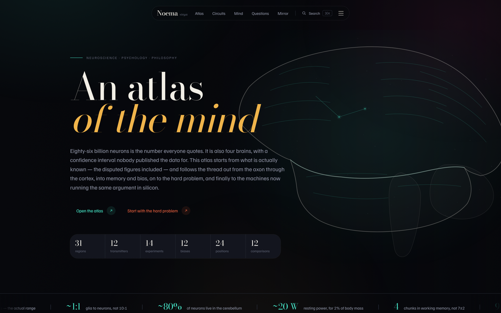
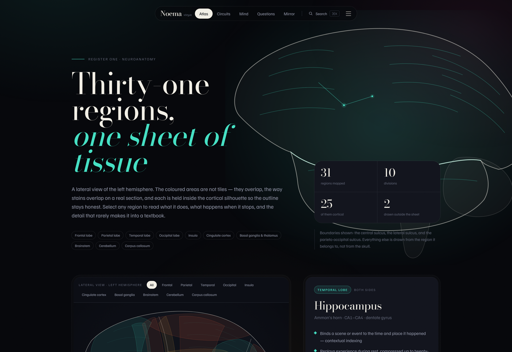
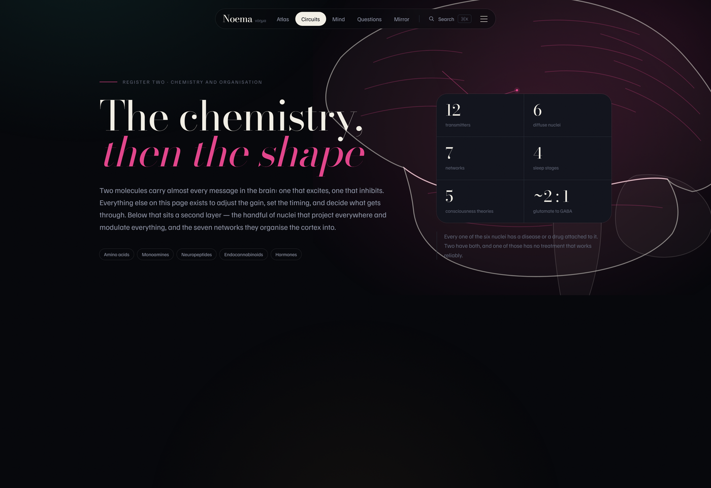
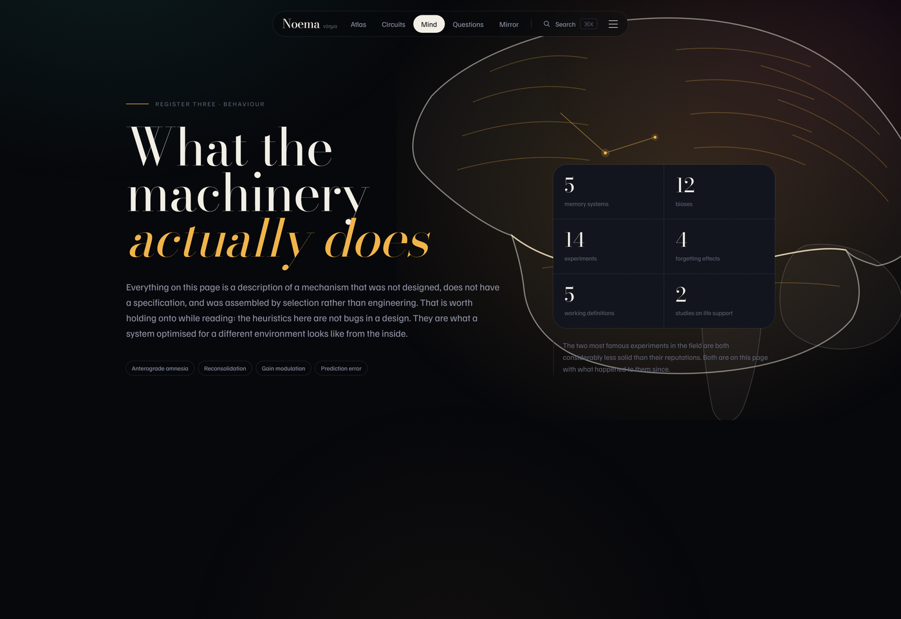
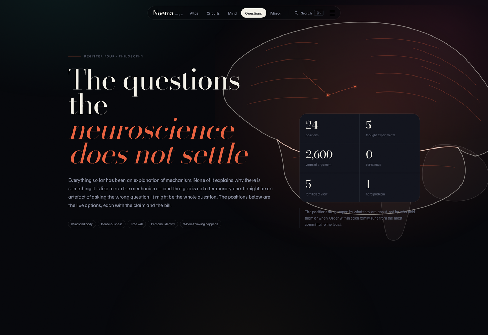
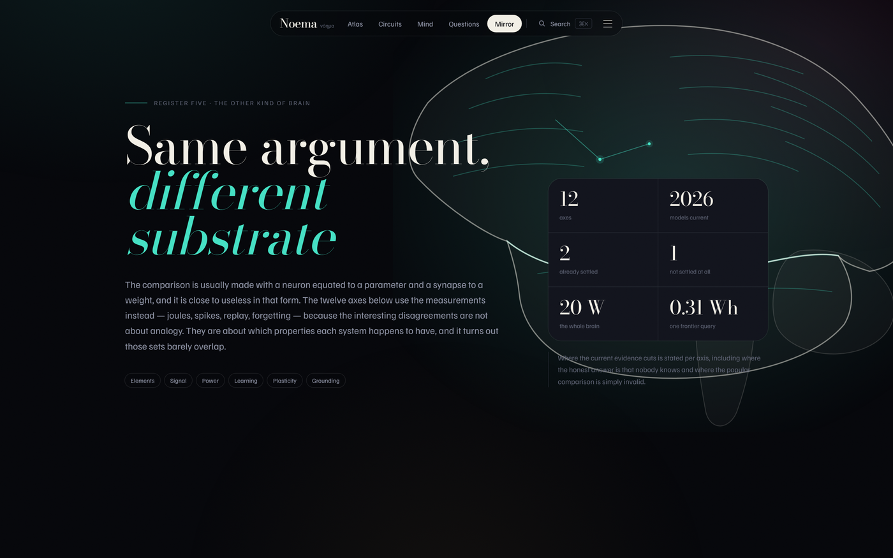
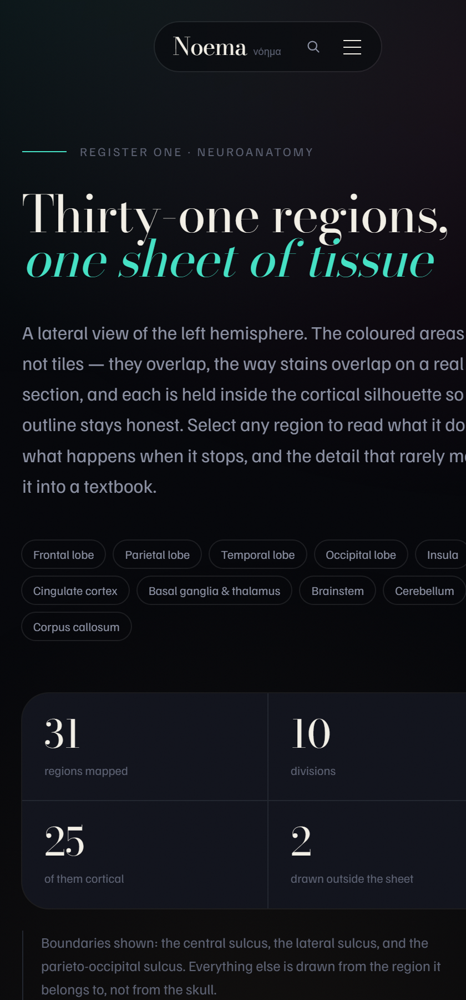

<p align="center">
  
</p>

<div align="center">

# νόηµα · Noema

### An atlas of the mind — from the axon up to the argument, and back down to the machine

**[Live →](https://noema-atlas.vercel.app)** · **[GitHub](https://github.com/aniruddhaadak80/noema)**

An interactive atlas of the human brain and mind. 31 cortical and subcortical regions, 12 neurotransmitters, 7 large-scale networks, 14 landmark experiments, 12 cognitive biases, 24 positions on the philosophy of mind, 5 thought experiments, and an honest comparison against a 2026 frontier AI model — every figure with its source and its dispute.

<br>


</div>

---

## Why this exists

Everyone knows the brain has 86 billion neurons. Almost nobody knows that the figure comes from **four brains**, that the sample data were **never published**, that the 95% confidence interval on that mean spans **roughly 73 to 99 billion**, and that a second study of five older women came back with **61–73 billion** — a range that does not overlap.

Nine whole human brains have ever been counted by isotropic fractionation. Everything else in neuroscience is inference from partial data, metaphor, and a century of careful work on things that turn out to be shakier than their reputations.

Noema is built on that premise. Where a famous number is contested, it is shown as contested. Where a famous study is weaker than its reputation, that is stated plainly. The atlas covers the same ground as any reference — anatomy, chemistry, behaviour — and then continues into the questions that a complete physical account does not settle.

---

## What is inside

| | Section | Registers |
|---|---|---|
| **01** | **Atlas** | 31 regions, 10 divisions, 3 sulcal boundaries |
| **02** | **Circuits** | 12 transmitters, 6 nuclei, 7 networks, 4 sleep stages, 5 theories |
| **03** | **Mind** | 5 memory systems, 12 biases, 14 experiments, 4 effects, 5 concepts |
| **04** | **Questions** | 24 positions, 5 thought experiments, 5 families of view |
| **05** | **Mirror** | 12 comparison axes, power and trajectory |

**Totals** — 31 regions · 12 transmitters · 6 nuclei · 7 networks · 4 sleep stages · 5 theories of consciousness · 5 memory systems · 12 biases · 14 experiments · 4 forgetting effects · 5 concepts · 24 positions · 5 thought experiments · 12 comparison axes.

---

## The atlas

<p align="center">
  
</p>

A lateral view of the left hemisphere. The coloured areas are **not tiles** — they overlap, the way stains overlap on a real histological section, and every regional shape is clipped to the cortical silhouette so the outline stays honest.

Two masses, not one: the cerebrum and the temporal lobe are separate paths joined along the lateral sulcus, because that is the anatomy. Cortical regions clip to the cerebrum, temporal regions to the temporal lobe, and the deep structures to both with a **dashed** edge — because on a lateral surface you cannot actually see them, and a drawing that pretends otherwise is lying to you.

Each of the 31 regions carries four things: what it does, what happens when it stops, the detail that rarely makes it into a textbook, and alternate names people actually search for.

---

## The circuits

<p align="center">
  
</p>

Twelve transmitters, each with the precursor, the receptor families, a two-line description of what it is for, and **both** the excess and deficit columns — because a transmitter described only by what it does has told you a fraction of the truth.

Six diffuse neuromodulatory nuclei (raphe, locus coeruleus, VTA, substantia nigra, nucleus basalis, tuberomammillary), the seven canonical large-scale networks found by task-subtraction fMRI, a full night of sleep in four stages, and the five leading theories of consciousness stated with what each one actually stakes.

---

## The mind

<p align="center">
  
</p>

Five memory systems with different substrates, different half-lives, and the single dissociation — H.M. — that produced most of what we know about them.

Twelve biases, each with **three** columns: the mechanism, what the shortcut bought, and what it charges. A bias without its payoff is just a complaint, and most write-ups stop at the complaint.

Fourteen landmark experiments. The two most famous in the field are the Stanford Prison Experiment, which is substantially discredited including fabricated data and an experimenter who coached his own guards, and the Little Albert study, whose own published account was never reconciled with the raw notes. Both are here, with what happened to them since.

---

## The questions

<p align="center">
  
</p>

Twenty-four positions on the mind–body problem, consciousness, free will, personal identity and embodied cognition. Each is stated with its claim **and what it costs to hold it** — Descartes gets the interaction problem, Chalmers gets the charge that his position is a research programme with no methods, and Sellars gets nothing at all because he was answering a different question.

Five thought experiments, each followed by the strongest objection to it, because a thought experiment that nobody objects to is usually not doing work.

---

## The mirror

<p align="center">
  
</p>

Twelve axes of comparison between a human brain and a 2026 frontier mixture-of-experts model, using the measurements rather than the analogy.

The headline finding is the one nobody noticed: **hardware efficiency already crossed over.** A frontier model at roughly one joule per output token, generating at the pace of human speech — about five tokens per second — draws around five watts, against the brain's twenty. Raw operations per joule are within a factor of a few and on some accounting ahead.

The brain remains ahead on the only measure that matters for usefulness: energy per unit of delivered cognition. Conscious human throughput is around ten bits per second; a frontier agentic session burns one to twenty million tokens for a day's work, which is thirty to seven hundred watts of effective thinking. Beating the brain on hardware is not the same as beating it on outcomes, and the distance between those two sentences is where the entire argument about this topic actually lives.

---

## Design

The brief ruled out a lot: no Inter, Roboto, Arial, Open Sans or Helvetica; no thick-stroked Lucide, FontAwesome or Material icons; no generic 1px grey borders; no harsh drop shadows; no edge-to-edge sticky navbars; no `linear` or `ease-in-out`; no instant state changes.

Everything visible is a choice about this subject instead.

| | |
|---|---|
| **Palette** | `#06070b` ground — deep ink, not tinted black. Four accents, each taken from how brains are actually stained: **Golgi magenta** `#e2458b` (silver impregnation), **immunofluorescence cyan** `#45e0c4` (GFP / Nissl), **melanin amber** `#f0b44a` (lipofuscin and neuromelanin), **vessel red** `#e8613f` (arterial). These are literally the colours on a fluorescence scope, viewed on black. |
| **Typography** | **Bodoni Moda** for display — the Didone cut used on 19th-century anatomical plates, which is where this iconography comes from. **Familjen Grotesk** for the interface. Two families, far enough apart that a heading never reads as body copy. Both variable, self-hosted via `next/font` with zero network requests. |
| **Lighting** | Two fixed radial washes, cool on the left hemisphere and warm on the right, plus a single fixed film-grain overlay at 3.2% opacity. Both are `position: fixed` and `pointer-events: none`, so they never trigger a repaint during scroll. |
| **Object architecture** | No card sits flat on the background. Everything uses the double-bezel: an outer shell with its own fill and a hairline, and an inner core with a *concentric, smaller* radius — `2rem` outside, `calc(2rem - 0.375rem)` inside — and an inset highlight along the top edge, the way a glass plate looks set into an aluminium tray. |
| **Motion** | One easing curve everywhere: `cubic-bezier(0.32, 0.72, 0, 1)`. The hero runs a single load sequence and then stops. The fact rail scrolls because it is a readout. Everything else is `transform` and `opacity` only — nothing on the site animates a layout property, and `backdrop-blur` appears only on the nav and the command palette. |
| **Measure** | Body copy caps at 68ch, with 76ch for the long-form philosophical entries. Section padding runs `py-24` to `py-40`. |

### Responsive & accessibility

Collapses to a single column below `768px` with `px-4` — every asymmetric override resets. `prefers-reduced-motion` disables the rail, the hero field, and all entrance transitions. Every SVG region is a focusable `role="button"` with `aria-pressed` and a descriptive label, and the nav is fully keyboard-operable. A skip link is the first focusable element on the page.

---

## Screenshots

<p align="center">
  &nbsp;
</p>
<p align="center">
  &nbsp;
</p>

<details>
<summary>Mobile view (atlas, 420px)</summary>
<br>

</details>

---

## Getting started

```bash
git clone https://github.com/aniruddhaadak80/noema.git
cd noema

npm install
npm run dev        # http://localhost:3000
```

### Commands

| Command | What it does |
|---|---|
| `npm run dev` | Development server with Turbopack HMR |
| `npm run build` | Production build (all 11 routes statically prerendered) |
| `npm run start` | Serve the production build |
| `npm run lint` | ESLint, flat config |

### Scripts in `scripts/`

| Script | |
|---|---|
| `preview.ps1` | Builds, starts `next start`, rasterises the atlas SVG through sharp to verify it renders as a brain rather than a set of paths |
| `screenshots.ps1` | Captures every route with headless Edge at 2× device scale |
| `render-brain.cjs` | Pulls the SVG out of the rendered page and rasterises it to `brain-check.png` |

---

## Stack

- **Next.js 16.4** — App Router, Cache Components, Partial Prefetching, Turbopack
- **React 19.3** with the React Compiler available but off
- **TypeScript 5** strict
- **Tailwind CSS v4** — `@theme` tokens, no config file
- **`next/font`** — Bodoni Moda and Familjen Grotesk, self-hosted
- **Vercel** — static prerender of all routes, SSO protection off so the site is public

Every page is a Server Component. The client bundle is three components — the nav, the command palette, and the canvas hero — and the scroll-reveal observer is a single `client` module in the layout that finds `[data-reveal]` as it arrives. No page ships per-card JavaScript.

---

## Data sources

- Herculano-Houzel & Lent, the isotropic fractionator — *Frontiers in Human Neuroscience*, 2009
- von Bartheld, Bahney & Herculano-Houzel, 150 years of cell counting — *J. Comp. Neurol.*, 2016
- Goriely, "Eighty-six billion and counting" — *Brain*, 2024
- Yeo et al., 17-network parcellation — *J. Neurophysiology*, 2011
- Raichle et al., the default mode network — *PNAS*, 2001
- Oviedo et al., energy of AI inference — *Joule*, 2026
- Epoch AI, power demands of frontier training — 2025

---

## License

MIT. Not medical advice and not a clinical reference. Figures are from the literature as of October 2026 and several are actively disputed — which is the point of the thing.

<div align="center">
<br>
<sub>Built by <a href="https://github.com/aniruddhaadak80">Aniruddha Adak</a> — a neuroscience, psychology and philosophy atlas for anyone who has ever read "we only use 10% of our brains" and wanted the actual numbers.</sub>
</div>
